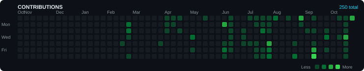
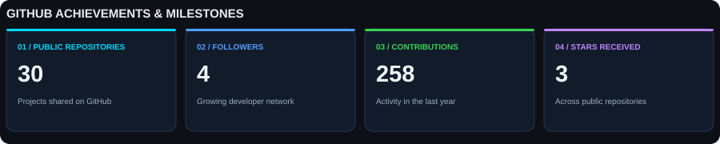

# 👋 Yash Gupta
### Backend Engineer · Java & Spring Boot Developer · Full Stack Engineer

  
  
  

<!-- Keep this animated blue divider -->

## ⚡ A Little About Me

I'm a software developer from India who enjoys turning ideas into practical, reliable applications.

My primary focus is **Java backend development**, building REST APIs, designing application architecture, and connecting backend systems with modern web interfaces. I also explore AI-powered applications and technologies that help solve real-world problems.

- 🔧 Building backend applications with Java and Spring Boot
- 🏗️ Exploring microservices, security, and system design
- 🌐 Developing full-stack applications with React
- 🤖 Exploring AI integration and intelligent application workflows
- 🧩 Improving problem-solving skills through DSA
- 🚀 Interested in building software that is useful, maintainable, and scalable

---

## 📌 Projects Worth Exploring

<table>
  <tr>
    <td width="33%" valign="top">
      <h3>🧭 CareerCompass</h3>
      
An AI-powered career platform designed to help users understand their skills, improve their resumes, explore relevant opportunities, and plan their career growth.

      
<strong>Focus:</strong> AI integration · Career insights · Personalized roadmaps

      
<code>Java</code> <code>Spring Boot</code> <code>AI</code>

      <a href="https://github.com/codemasteryash/careercompass-backend">View Repository →</a>
    </td>
    <td width="33%" valign="top">
      <h3>⚖️ NyayaPath</h3>
      
A legal-tech platform focused on helping users understand legal issues, explore relevant legal sources, and organize practical next steps.

      
<strong>Focus:</strong> Legal research · AI-assisted analysis · Action planning

      
<code>React</code> <code>Node.js</code> <code>FastAPI</code>

      <a href="https://github.com/codemasteryash/nyayapath-legal-tech">View Repository →</a>
    </td>
    <td width="33%" valign="top">
      <h3>⚙️ Spring Boot 3 Microservices</h3>
      
A hands-on microservices project exploring service separation, API routing, inter-service communication, and containerized deployment.

      
<strong>Focus:</strong> Backend architecture · REST APIs · Deployment

      
<code>Java</code> <code>Spring Boot</code> <code>Docker</code>

      <a href="https://github.com/codemasteryash/spring-boot-3-microservices">View Repository →</a>
    </td>
  </tr>
</table>

## 🛠️ My Technology Stack

<table>
  <tr>
    <td width="50%" valign="top">
      <h3>Backend & Architecture</h3>
      
        
      <code>Spring Boot</code> <code>Spring Security</code>
      <code>Spring Data JPA</code> <code>REST APIs</code>
      <code>Microservices</code>
    </td>
    <td width="50%" valign="top">
      <h3>Frontend</h3>
      
        
      Building responsive interfaces and integrating them with backend services.
    </td>
  </tr>
  <tr>
    <td width="50%" valign="top">
      <h3>Databases & Infrastructure</h3>
      
        
      <code>PostgreSQL</code> <code>MySQL</code> <code>MongoDB</code>
      <code>Redis</code> <code>Docker</code> <code>Kubernetes</code>
    </td>
    <td width="50%" valign="top">
      <h3>Development Tools</h3>
      
        
      <code>Maven</code> <code>GitHub Actions</code>
      <code>JUnit</code> <code>Mockito</code>
    </td>
  </tr>
</table>

---

## 📊 GitHub Overview

  
  

  

## 📈 Contribution Graph

---

## 🏆 GitHub Achievements

---

## 🎯 What I'm Working Towards

- Building better backend architectures and reliable APIs
- Improving my understanding of distributed systems and microservices
- Exploring AI-powered features in practical applications
- Writing cleaner, more maintainable code
- Strengthening DSA and software design fundamentals
- Collaborating on projects that solve meaningful problems

---

## 🤝 Let's Connect

  
  
  

 

### `Build → Learn → Improve → Repeat`

*“First make it work, then make it right, then make it scalable.”*

Thanks for stopping by. Always building, always learning.

